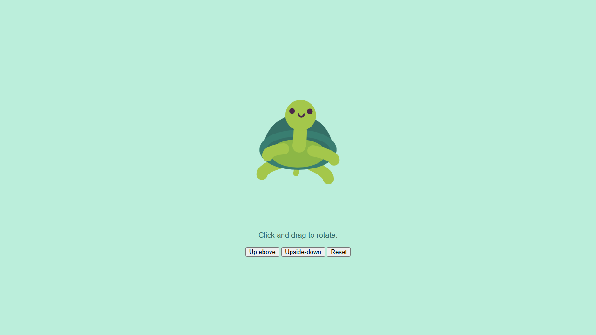

# Happy-Turtle-Adoption-Day

**Live demo:** https://chandrasen74.github.io/Happy-Turtle-Adoption-Day/  
**Repository:** https://github.com/Chandrasen74/Happy-Turtle-Adoption-Day



## Overview
`Happy-Turtle-Adoption-Day` is a HTML/CSS/JavaScript project.
- **Primary language:** JavaScript
- **Languages detected:** HTML, JavaScript, CSS
- **Stack/tech:** HTML, CSS, JavaScript
- **Entry point:** `index.html`
- **Key files:** `index.html`

## Language & stack details
- Languages: HTML, JavaScript, CSS
- Frameworks/tools/libraries: HTML, CSS, JavaScript

## How to install & run
### Prerequisites
- A modern web browser
- (Optional) [Python 3](https://www.python.org/) or any static file server for local serving

### Run locally
```bash
git clone https://github.com/Chandrasen74/Happy-Turtle-Adoption-Day.git
cd Happy-Turtle-Adoption-Day
```
- **Option 1:** open `index.html` directly in your browser
- **Option 2:** serve locally (recommended for some JS features):
```bash
python -m http.server 8000
# then open http://localhost:8000
```

## Repository structure (top-level/sample)
- `README.md`
- `index.html`
- `screenshot.png`
- `script.js`
- `style.css`
- `turtle-icon.png`

## Status
Documented with screenshot, language/stack details, and setup instructions as part of a profile-wide README update.
